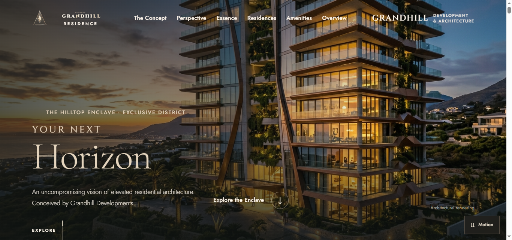
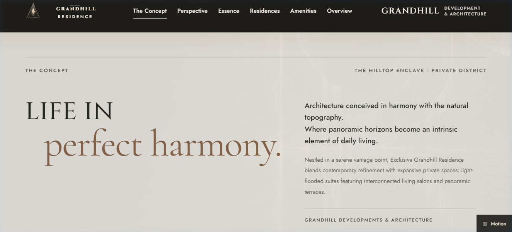
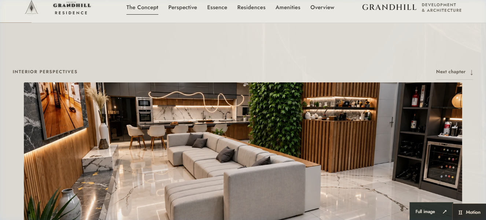
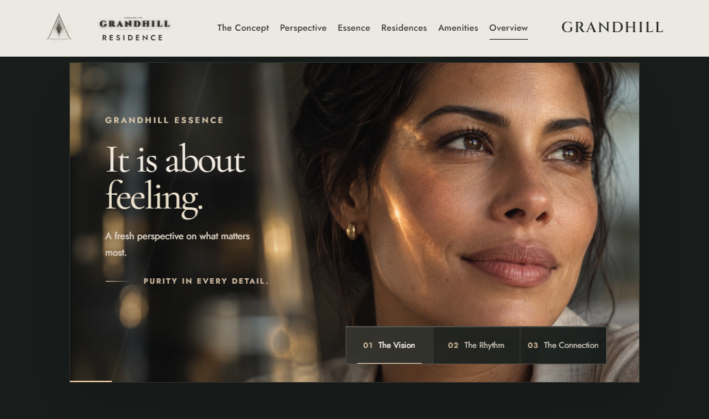
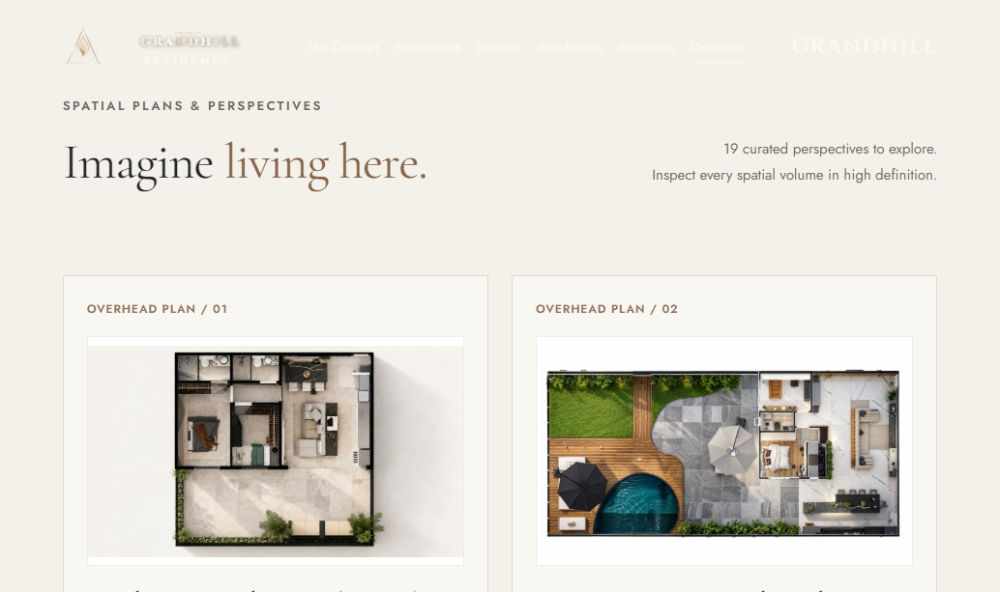

# Exclusive Grandhill Residence

A digital monograph and interactive showcase for Exclusive Grandhill Residence, an elevated residential development featuring contemporary architecture, panoramic hilltop vistas, and bespoke residential design.

**Live Demonstration**: [https://grandhill-estate.vercel.app/](https://grandhill-estate.vercel.app/)



---

## Overview

This project delivers a high-performance, editorial-grade web experience with zero framework overhead. It incorporates scroll-driven lighting choreography, high-resolution architectural photography, an interactive spatial suite explorer, and responsive layout systems designed for luxury real estate presentations.

---

## Live Demonstration

The production deployment is hosted and distributed globally via Vercel:

- **Production URL**: [https://grandhill-estate.vercel.app/](https://grandhill-estate.vercel.app/)
- **Repository**: [https://github.com/iqbal-alpha/grandhill-estate](https://github.com/iqbal-alpha/grandhill-estate)

---

## Visual Highlights

### The Concept & Architectural Monograph
Editorial typography and landscape narrative detailing the architectural vision and natural topography integration.



### Curated Interior Living Salons
Layered photographic journeys presenting panoramic living areas, integrated designer kitchens, and bespoke finishes.



### Grandhill Essence Monograph
Human-centric architectural philosophy explored through curated lighting, materiality, and interactive portrait chapters.



### Overhead Spatial Plans & Specifications
High-definition architectural layout studies illustrating private suite configurations, master en-suites, and horizon terraces.



---

## Key Features

- **Hero Atmospheric Transition**: Scroll-synchronized dusk-to-night lighting crossfade showcasing the architectural facade under varying daylight conditions.
- **Cinematic Entrance Experience**: Zero-FOUC dark luxury opening screen drawing vector crystal geometry before revealing the primary facade.
- **Curated Interior & Amenity Journeys**: Layered sticky photobands and synchronized architectural captions with high-resolution modal inspection.
- **Architectural Floor Plan Explorer**: Interactive suite layout viewer featuring spatial specifications, area metrics, and noble finish schedules.
- **Motion & Accessibility**: Integrated motion toggle honoring `prefers-reduced-motion` settings, keyboard navigation, and semantic HTML5 hierarchy.

---

## Technology Stack

- **Markup & Styling**: HTML5, Vanilla CSS3 (Custom Design System, CSS Variables, Clamp Typography)
- **Logic & Interactions**: Modern JavaScript (ES Modules), GSAP, ScrollTrigger, Three.js
- **Asset Pipeline**: WebP image delivery, SVG vector marks, self-hosted web fonts
- **Runtime**: Native Node.js HTTP server (no build step or bundler required)

---

## Project Structure

```text
├── assets/
│   ├── acervo/          # High-resolution architectural photography
│   ├── crystal/         # Textures and backdrop assets
│   ├── images/          # Facade and hero imagery (sunset & night)
│   └── fonts/           # Typography assets
├── docs/
│   └── screenshots/     # Precision-cropped interface captures for documentation
├── vendor/
│   ├── gsap.min.js
│   ├── ScrollTrigger.min.js
│   └── three.module.min.js
├── grandhill.css        # Core stylesheet and layout tokens
├── grandhill-cinema.js  # WebGL 3D helix gallery controller
├── grandhill-essence.js # Spatial feature tabs controller
├── grandhill.js         # Navigation, lightbox, and global interactions
├── index.html           # Main semantic document
├── server.js            # Zero-dependency local development server
└── vercel.json          # Deployment configuration for Vercel
```

---

## Getting Started

### Prerequisites

- Node.js 18.0.0 or higher

### Installation & Local Run

1. Clone the repository:
   ```bash
   git clone https://github.com/iqbal-alpha/grandhill-estate.git
   cd grandhill-estate
   ```

2. Start the local development server:
   ```bash
   npm start
   ```

3. Open your browser and navigate to:
   ```text
   http://localhost:3000
   ```

---

## Deployment

The project is structured as a static deployment. Configuration for Vercel is included in `vercel.json` with appropriate MIME types and cache headers.

To deploy via Vercel CLI:
```bash
vercel
```

Automatic CI/CD is enabled via GitHub repository integration with Vercel for continuous deployment on push to `main`.

---

## License

Private portfolio demonstration. All architectural renderings, photography, and design concepts are presented for demonstration and development purposes.
